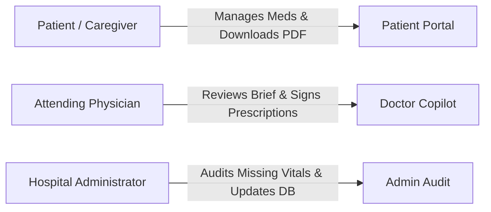
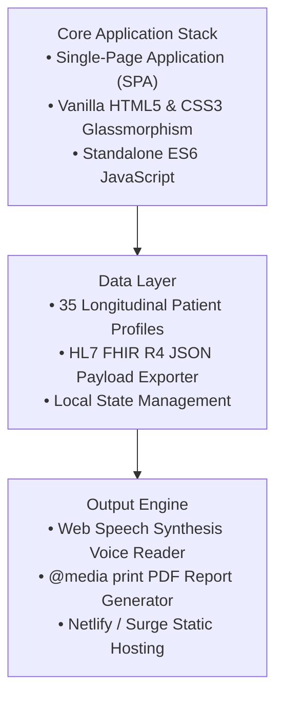

# Product Requirement Document (PRD)
# CuraLink AI – Intelligent AI Healthcare Assistant Agent

---

## 1. Document Control & Metadata

| Attribute | Details |
| :--- | :--- |
| **Project Title** | CuraLink AI – Intelligent AI Healthcare Assistant Agent |
| **Document Type** | Product Requirement Document (PRD) |
| **Target Event** | National-Level AI Agent Hackathon |
| **Version** | 2.0.0 (Master Release) |
| **Status** | Approved & Fully Implemented |
| **Target Location** | `C:\Users\ntbha\.gemini\antigravity\scratch\curalink_ai` |

---

## 2. Executive Summary & Vision Statement

### 2.1 Problem Statement
Fragmented medical histories across hospital systems lead to delayed diagnoses, adverse drug interactions, unmanaged medication non-adherence, and administrative friction for physicians. Patients struggle to understand complex clinical reports, while doctors waste valuable consultation time sifting through dense electronic health records (EHRs).

### 2.2 Product Vision
**CuraLink AI** is a modern, secure, AI-powered healthcare web platform that centralizes every patient's complete medical history using a unique **Patient Record ID**. The platform continuously analyzes health records using AI, proactively detects risks, generates clinical insights, assists doctors with decision-making, helps patients manage their health, and automates healthcare workflows.

The application features a clean, futuristic UI with smooth animations, glassmorphism cards, responsive layouts, modern dashboards, and enterprise-level user experience suitable for a national hackathon showcase.

---

## 3. User Personas & Core Workflows

### 3.1 Persona 1: Eleanor Vance (Elderly Patient / Patient Persona)
- **Goal**: Manage daily medications, understand pill interactions, review simple executive summaries, and share official PDF medical reports with family.
- **Pain Points**: Small browser text, confusing drug names, uncertainty over whether a pill should be taken with food.

### 3.2 Persona 2: Dr. Marcus Vance (Cardiologist / Doctor Persona)
- **Goal**: Quickly review a patient's 6-month longitudinal history before a 10-minute consultation and verify patient-uploaded lab documents.
- **Pain Points**: Sifting through 40-page PDF records, missing subtle vitals trends over time.

### 3.3 Persona 3: Hospital Admin / Data Auditor Persona
- **Goal**: Ensure 100% data completeness across all 35 hospital patient records, alert medical staff when vitals are missing >60 days, and update incomplete database fields.

---

## 4. Functional Specifications

### 4.1 Global Controls & 35-Patient Dataset
- **Patient Switcher**: Instant switching across 35 realistic patient profiles (`PAT-1001` to `PAT-1035`).
- **Instant Search Engine**: Live filtering input bar searching across Patient ID, Name, Mobile Number, DOB, and Assigned Doctor.
- **Multilingual Support**: Deep translation across 6 South Asian languages:
  1. 🇺🇸 English
  2. 🇮🇳 தமிழ் (Tamil)
  3. 🇮🇳 हिंदी (Hindi)
  4. 🇮🇳 తెలుగు (Telugu)
  5. 🇮🇳 ಕನ್ನಡ (Kannada)
  6. 🇮🇳 മലയാളം (Malayalam)
- **Native Web Speech Engine**: Integrated TTS voice reader for accessibility.
- **Elder Accessibility Mode**: High contrast black background with 24px+ text scaling.

### 4.2 Patient Portal Features
1. **AI Health Score Gauge**: Dynamic 0-100 score reflecting vitals stability and medication adherence.
2. **Specified Active Current Medications Table**: Explicit columns for Medication Name, Dosage & Frequency, Clinical Purpose, Remaining Stock (tabs), Days Left, Refill Due Date, and Expiry.
3. **AI Medicine Safety Scanner with Step-by-Step Eating Advice**:
   - Presets & prescription file upload support.
   - Explicit verdict banners: **🟢 SAFE TO EAT / TAKE**, **🔴 DO NOT EAT / TAKE (Allergy / Interaction Conflict)**, or **🟡 AI VERIFICATION UNCERTAIN**.
   - Actionable eating guide (*"Take 1 tablet once daily in the morning after breakfast with water"*).
4. **Short & Sweet 30-Second Executive Summary Modal**: 3-paragraph quick snapshot accessed via the `30-Sec Summary` button.
5. **AI Automatic Appointment Consultation Booking Engine**:
   - Auto-selects recommended specialist (*Dr. Marcus Vance - Cardiology*).
   - Time slot selector chips (*Tomorrow 10:00 AM*, *Friday 02:30 PM*, *Monday 11:15 AM*).
   - 1-click booking confirmation with caregiver notifications.
6. **Smart Medicine Schedule & Daily Reminder Alarms**:
   - Morning (08:00 AM), Afternoon (02:00 PM), Evening (08:00 PM) dose cards.
   - Interactive `Mark Dose Taken ✅` and `Snooze 15 Mins ⏰` buttons that recalculate Adherence Rate (%) in real time.
7. **Interactive Longitudinal Health Analytics Dashboard**:
   - 6-metric trend charts (Blood Pressure, Fasting Glucose & HbA1c, Heart Rate & SpO2, Weight & BMI).
   - Timeframe filter buttons (**6 Months**, **1 Month**, **1 Year**).
8. **Download Health Summary PDF Exporter**:
   - `@media print` CSS engine formatting patient profile, active meds, history, and lab panels into an official printable PDF summary.

### 4.3 Doctor Copilot & Clinical Timeline Portal
1. **10-Second Executive Clinical Brief**: AI inference snapshot of primary conditions and vitals.
2. **Lab Anomaly Detector**: Highlights elevated markers (`HbA1c 8.4% ↑`, `Serum Creatinine 1.45 mg/dL ↑`).
3. **Interactive AI Clinical Timeline**: Chronological node map detailing visits, lab tests, surgeries, and AI observations.
4. **Hospital Verification Queue**: One-click authorization (`"✅ Authorize & Verify"`) for patient-uploaded scans.
5. **Digital Prescription Writer**: Real-time prescription input and authorization signature.

### 4.4 Admin Audit Portal
1. **Missing Data Warning Banner**: Alerts when hospital patient records have vitals older than 60 days.
2. **One-Click Staff Alert Dispatcher**: Dispatches SMS/Push notifications to assigned doctors.
3. **Admin Hospital Database Updater Form**: Allows inline updating of Blood Pressure, Glucose, Prescriptions, and Notes, automatically updating status to `Record Complete & Verified`.
4. **Master 35-Patient Verification Roster**: Complete roster of all hospital records.

---

## 5. Technical Architecture & Technology Stack

| Component | Technology / Implementation |
| :--- | :--- |
| **Frontend Framework** | HTML5, CSS3 Vanilla Glassmorphism Design System, ES6 JavaScript |
| **Icons & Typography** | FontAwesome 6.4.0, Google Fonts (Outfit, Inter) |
| **Speech & Audio** | Native HTML5 `SpeechSynthesisUtterance` API |
| **Export Formats** | HL7 FHIR R4 JSON bundle, Printable PDF via `@media print` |
| **Deployment** | Explorer Local File System, Netlify Drag & Drop, Surge CLI |

---

## 6. Non-Functional Requirements (NFRs)

1. **Performance**: Zero external API dependencies required for core execution; sub-50ms UI state transitions.
2. **Zero-Hallucination Guardrails**: AI safety verdicts strictly check documented patient allergy arrays and active drug conflict matrices before rendering verdicts.
3. **Accessibility**: Fully usable in Elder Mode with 24px+ text scaling and high contrast.
4. **Interoperability**: Standard HL7 FHIR R4 JSON schemas (`Patient`, `Observation`, `MedicationStatement`) generated for seamless hospital EHR integration.
