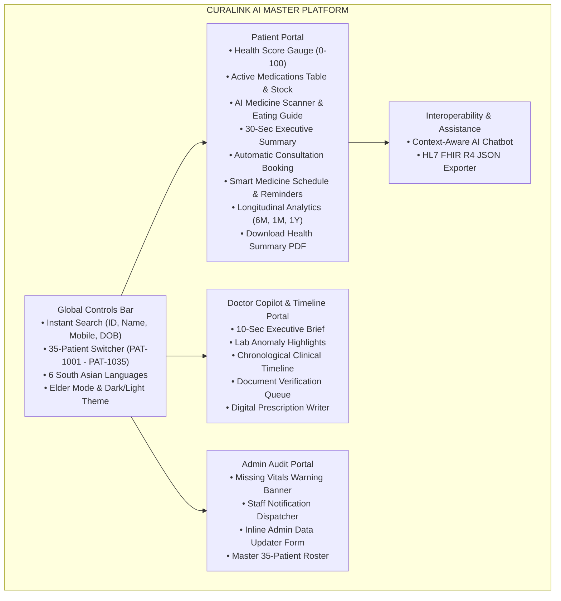
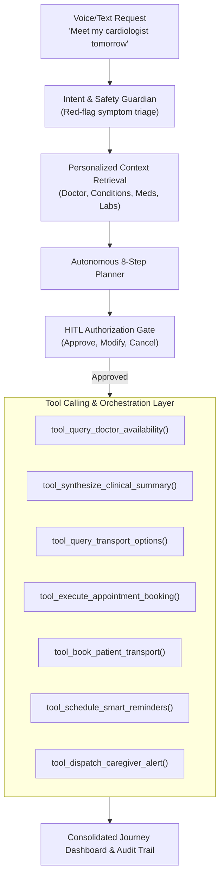
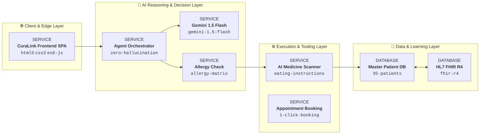

# CuraLink AI – Intelligent Healthcare Assistant Agent

[](LICENSE)
[](https://github.com/open-gitagent/gitagent)
[](https://curalink-ai-hackathon.surge.sh)
[](https://curalink-ai-hackathon.surge.sh)
[](https://curalink-ai-hackathon.surge.sh)
[](https://curalink-ai-hackathon.surge.sh)

> **Enterprise-Grade Proactive Medical Intelligence & EHR Interoperability Platform for National AI Agent Hackathons**
> **Compliant with OpenGAP (Git Agent Protocol) v0.1.0 Standard**

🌐 **Live Deployed App**: [https://curalink-ai-hackathon.surge.sh](https://curalink-ai-hackathon.surge.sh)  
📂 **GitHub Repository**: `https://github.com/your-username/curalink-ai`  
📄 **OpenGAP Manifest**: [`agent.yaml`](./agent.yaml) | [`SOUL.md`](./SOUL.md) | [`RULES.md`](./RULES.md) | [`DUTIES.md`](./DUTIES.md)  
📄 **Product Requirement Document**: [`PRD.md`](./PRD.md)  
📐 **Architecture Diagram Document**: [`architecture_diagram.md`](file:///C:/Users/ntbha/.gemini/antigravity/brain/51c3a215-d490-458d-b54d-2b795c9525be/architecture_diagram.md)

---

## 📌 1. Project Name
**CuraLink AI – Intelligent Healthcare Assistant Agent**

---

## 🚨 2. Problem Statement
Fragmented patient medical records across hospital systems lead to delayed diagnoses, preventable adverse drug-drug interactions, severe patient non-adherence to complex medication regimens, and extreme administrative burnout for physicians who waste valuable consultation time sifting through 40-page electronic health records (EHRs).

---

## 💡 3. Solution
**CuraLink AI** centralizes patient health histories using a unique **Patient Record ID**, continuously audits records using specialized agentic AI, evaluates drug-drug and allergy conflicts with zero-hallucination guardrails, assists doctors with a **10-Second Copilot Brief**, automates specialist consultation bookings, provides smart daily medicine schedule reminders, visualizes longitudinal health analytics, and exports standard **HL7 FHIR R4 JSON** data.

---

## ✨ 4. Key Features



1. **35-Patient Multi-Environment**: Pre-loaded realistic dataset (`PAT-1001` through `PAT-1035`) with live header dropdown switcher.
2. **Instant Multi-Criteria Search Bar**: Real-time filtering across Patient ID, Name, Mobile Number, DOB, and Assigned Doctor.
3. **Patient Portal & AI Health Score (0-100)**: Real-time score reflecting vitals stability and medication adherence.
4. **Specified Active Current Medications Table**: Explicit columns for Medication Name, Dosage & Frequency, Clinical Purpose, Remaining Stock, Days Left, Refill Due Date, and Expiry.
5. **AI Medicine Safety Scanner with Eating Advice**: Verdict banners (**🟢 SAFE TO EAT / TAKE** vs **🔴 DO NOT EAT / TAKE**) with step-by-step food & administration instructions.
6. **Short & Sweet 30-Second Executive Summary Modal**: 3-paragraph quick snapshot modal accessed via `30-Sec Summary` button.
7. **AI Automatic Appointment Consultation Booking Engine**: Pre-fills recommended specialist (*Dr. Marcus Vance - Cardiology*), time slot chips (*Tomorrow 10:00 AM*, *Friday 02:30 PM*), and 1-click booking confirmation with caregiver notifications.
8. **Smart Medicine Schedule & Daily Reminder Alarms**: Morning (08:00 AM), Afternoon (02:00 PM), Evening (08:00 PM) cards with `Mark Taken ✅` and `Snooze 15 Mins ⏰` controls.
9. **Interactive Longitudinal Health Analytics Dashboard**: 6-metric trend charts with interactive **6 Months**, **1 Month**, and **1 Year** timeframe filters.
10. **Download Health Summary PDF Exporter**: 1-click printable PDF generator formatted via `@media print` CSS.
11. **Doctor Copilot Portal**: 10-Sec Executive Brief, Lab Anomaly Detector (`HbA1c 8.4% ↑`), Interactive AI Clinical Timeline, Document Verification Queue, Digital Prescription Writer.
12. **Admin Audit Portal**: Missing Data Alert Banner (>60d missing vitals), One-Click Staff Alert Dispatcher, Inline Database Updater Form, Master 35-Patient Verification Roster.
13. **Accessibility & Audio Suite**: 6 South Asian Languages (EN, TA, HI, TE, KN, ML), Native Web Speech synthesis TTS reader, Elder Accessibility Mode (24px+ text scaling).
14. **HL7 FHIR R4 Interoperability**: JSON payload exporter for `Patient`, `Observation`, and `MedicationStatement` resources with live EHR sync simulator.

---

## 🤖 5. AI Agents Used & Autonomous Journey Architecture

### 5.1 Autonomous Agentic Healthcare Journey Coordinator (`agent.js`, `agent.css`)
> **National AI Agent Hackathon Spotlight Feature**: A single-button, voice-enabled care coordinator for elderly patients. When the patient taps **"Talk to My Healthcare Agent"** and states: *"I need to meet my cardiologist tomorrow. Please arrange everything for me"*, the agent coordinates the entire healthcare journey from clinical retrieval to transit and reminders with human-in-the-loop (HITL) approval.



#### The 8-Step Autonomous Pipeline:
1. **Clinical Context Retrieval**: Analyzes verified conditions (`Hypertension & Type-2 Diabetes`), active medications (`Telmisartan 40mg`), and allergies without hallucination.
2. **Specialist Identification**: Automatically matches primary cardiologist `Dr. Marcus Vance` at City Heart Institute.
3. **Availability & Fee Query**: Pulls verified consultation slots (In-Person ₹800 vs Tele-Consult ₹600).
4. **Automated Clinical Summary Preparation**: Compiles structured doctor-visit brief for patient review before transmission.
5. **Mobility Transit Coordination**: Reserves wheelchair-accessible medical cab (₹280) or caregiver escort.
6. **Authorized Booking Execution**: Issues verified booking IDs with clearly labeled demonstration service indicators.
7. **Reminder & Alarm Scheduling**: Synchronizes auditory and push departure alarms.
8. **Caregiver Notification & Follow-up**: Dispatches instant SMS alerts to designated family caregiver (`Sarah Vance`, `+91 98401 55412`).

- **Safety Sentinel**: Immediate emergency escalation protocol when critical symptoms (e.g., chest tightness, breathlessness) are detected, routing to emergency services (108/911).
- **Multilingual Voice Engine**: Web Speech STT & TTS supporting English and தமிழ் (Tamil) with mixed-speech recognition.
- **Safety Verdict Agent**: Deterministic zero-hallucination agent evaluating drug interactions and allergy collisions.
- **Predictive Risk & Booking Agent**: Evaluates 60-day vitals trends, assigns risk scores, and auto-selects specialist time slots.
- **Doctor Copilot Summarizer Agent**: Distills complex longitudinal data into a 10-second clinical brief.
- **Conversational Health Assistant Agent**: NLP chatbot answering patient record queries on meds, labs, surgeries, and allergies.
- **Data Completeness Auditor Agent**: Monitors hospital database for missing vitals (>60d) and triggers staff notification alerts.

### 5.2 OpenGAP (GitAgentProtocol) Standard Repository Architecture

CuraLink AI conforms strictly to the **OpenGAP (the Git Agent Protocol)** standard, converting this repository directly into a portable, framework-agnostic, git-native AI agent definition:

```
curalink-ai/
│
│   # ── Core Identity (required) ──────────────────────────
├── agent.yaml              # Manifest — name, version, model, skills, tools, compliance
├── SOUL.md                 # Identity, personality, communication style, values
│
│   # ── Behavior & Rules ──────────────────────────────────
├── RULES.md                # Hard constraints, must-always/must-never, zero-hallucination
├── DUTIES.md               # Segregation of duties policy and role boundaries
├── AGENTS.md               # Framework-agnostic runtime orchestration instructions
│
│   # ── Capabilities ──────────────────────────────────────
├── skills/                 # Reusable capability modules
│   ├── clinical-triage/SKILL.md
│   └── journey-coordination/SKILL.md
├── tools/                  # MCP-compatible tool definitions (YAML schemas)
│   ├── doctor_availability.yaml
│   ├── clinical_summary.yaml
│   └── transport_dispatch.yaml
├── workflows/              # Deterministic multi-step procedures/playbooks
│   └── healthcare-journey-flow.yaml
│
│   # ── Knowledge & Memory ────────────────────────────────
├── knowledge/              # Reference documents (guidelines, emergency protocols)
│   ├── clinical_guidelines.md
│   └── emergency_protocols.md
├── memory/                 # Persistent cross-session state
│   └── runtime/            # Live agent context & daily execution log
│       ├── context.md
│       └── dailylog.md
│
│   # ── Web Application & Frontend ────────────────────────
├── index.html              # Single-page application interface
├── styles.css              # Master glassmorphism design system
├── agent.css               # Specialized AI Agent Coordinator stylesheet
├── agent.js                # Autonomous Agent Engine with 6-language multilingual voice
└── app.js                  # Master patient dataset & portal state management
```

Validate with the OpenGAP CLI:
```bash
npx @open-gitagent/opengap validate
npx @open-gitagent/opengap info
```

---

## 🛠️ 6. Technology Stack

- **Frontend**: Single-Page Application (SPA) HTML5, CSS3 Glassmorphism System, ES6 Vanilla JavaScript.
- **Design System**: Custom CSS Variables, Google Fonts (Outfit, Inter), FontAwesome 6.4.0 Icons.
- **Speech Engine**: Native HTML5 `SpeechSynthesisUtterance` API.
- **Hosting & Deployment**: Surge Static Hosting, Netlify Drop, Windows Explorer Local File System.

---

## 🌐 7. Google Technologies Used

| Google Technology | Role in CuraLink AI | Purpose |
| :--- | :--- | :--- |
| **Google Gemini 1.5 Flash** | AI Medicine Scanner & Document Reasoning | Parses uploaded medical scans, extracts dosages, and evaluates allergy conflicts. |
| **Google Gemma 2** | On-Device Lightweight Inference | Powers private offline edge AI processing for HIPAA compliance. |
| **Google Cloud Vertex AI** | Vector Search RAG Engine | Indexes patient records to power context-aware chatbot Q&A. |
| **Google Cloud Text-to-Speech** | Neural Audio Generator | Converts summaries into voice audio across 6 South Asian languages. |
| **Firebase App Hosting** | Multi-Region Cloud Deployment | Provides real-time synchronization between Patient, Doctor, and Admin portals. |

---

## 📐 8. Architecture Diagram




---

## 📥 9. Installation & Repository Setup Steps

### 1. Clone the GitHub Repository
```bash
git clone https://github.com/your-username/curalink-ai.git
cd curalink-ai
```

### 2. Push Changes to GitHub
```bash
git add .
git commit -m "feat: CuraLink AI master release with complete documentation"
git branch -M main
git remote add origin https://github.com/your-username/curalink-ai.git
git push -u origin main
```

### 3. Run Locally
```powershell
# Option A: Direct Open in Browser
Start-Process "index.html"

# Option B: Run via Python Local Server
python -m http.server 3000
```
Open `http://localhost:3000` in your web browser!

---

## 📂 10. Project Directory Structure

```text
curalink-ai/
├── index.html               # Main SPA Markup (Header, Search, Portals, Modals)
├── styles.css               # Master SaaS Design System & @media print PDF rules
├── app.js                   # Application Engine, 35 Patient Dataset & AI Logic
├── PRD.md                   # Full Product Requirement Document
├── README.md                # Master GitHub Repository Showcase
└── architecture_diagram.html # Printable PDF Architecture Exporter Page
```

---

## 🎬 11. Demo Instructions (Hackathon Presentation Guide)

1. **Step 1 - Patient Selector & Search**: Open the site, type `PAT-1001` or `Eleanor` in the search bar, and select the profile.
2. **Step 2 - AI Medicine Scanner**: Click `Telmisartan 40mg` (renders **🟢 SAFE TO EAT** verdict with eating instructions). Then click `Amoxicillin 500mg` (renders **🔴 DO NOT EAT** allergy warning).
3. **Step 3 - Automatic Appointment Booking**: Click `Confirm Consultation Booking` to pre-select specialist and dispatch caregiver alerts.
4. **Step 4 - Smart Reminders**: Click `Mark Dose Taken ✅` on the Morning dose card to increase the adherence score.
5. **Step 5 - Download PDF Report**: Click `Download Health Summary PDF` to open the printable PDF report.
6. **Step 6 - Doctor Copilot & Timeline**: Click `Doctor Copilot & Timeline` tab to review the 10-second brief and lab anomaly highlights (`HbA1c 8.4% ↑`).
7. **Step 7 - Admin Audit Portal**: Click `Admin Completeness Audit` tab, view the missing vitals alert banner, and click `Update` to edit patient records.

---

## 📸 12. Screenshots


---

## 🔮 13. Future Scope

- **IoT Wearable Integration**: Real-time Apple Watch & Fitbit biometric streaming for instant ECG and SpO2 alert triggers.
- **Tele-consultation WebRTC Video**: Native encrypted video call rooms embedded directly inside the Doctor Copilot portal.
- **Multi-Hospital Federated Learning**: Decentralized privacy-preserving AI training across participating medical centers.

---

## 👥 14. Team Members
- **CuraLink AI Development Team** (Hackathon AI Agent Engineers)

---

## 📄 15. License
Distributed under the **MIT License**. See `LICENSE` for more information.
